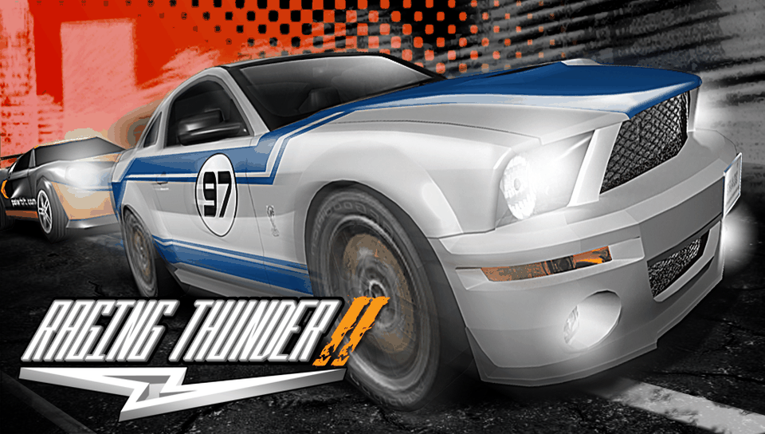

<p align="center">
  
</p>

<h1 align="center">
  Raging Thunder 2 · PS Vita Port
</h1>

<p align="center">
  <b>Native port of Raging Thunder 2 (Polarbit) for PlayStation Vita and PlayStation TV.</b>
</p>

<p align="center">
  <a href="https://github.com/MetalSyntax/Raging-Thunder-2-vita/releases"></a>
  
  
  
  
  
  
  <a href="LICENSE"></a>
</p>

<p align="center">
  <a href="#-description">Description</a> •
  <a href="#-features">Features</a> •
  <a href="#-controls">Controls</a> •
  <a href="#-installation">Installation</a> •
  <a href="#-known-issues">Known Issues</a> •
  <a href="#-building-from-source">Build</a> •
  <a href="#-credits">Credits</a>
</p>

---

## 📖 Description

Unofficial port of **Raging Thunder 2** (Polarbit, Android, APK v1.0.16) to the PS Vita. It runs the unmodified ARM game
library `librthunder2lite.so` (`armeabi`) through a native loader (TheFloW's so-loader + FalsoJNI), with rendering via vitaGL.

Raging Thunder 2 is an arcade racing game originally released for Android (Polarbit Fuse engine, GLES 1.1).
This port loads the unmodified `librthunder2lite.so` and re-implements the Android/Java layer it expects: lifecycle,
EGL/GLES 1.1, touch/key/accelerometer input, audio mixing, file access and LiveArea, so the game runs natively on the Vita.

> **Disclaimer:** this project contains no game assets. You must provide your own legally obtained copy of the game
> (APK v1.0.16). See [Installation](#-installation).

---

## 🎮 Status & Playability

**Status: Playable (v1.1.2)**: menus and races are fully playable on real hardware.

- Gameplay: menus and races fully playable on real hardware.
- Rendering: vitaGL (vendored, softfp), MSAA up to 4x, 960×544.
- Input: buttons, touch screen, left-stick tilt emulation and real motion controls.
- Audio: engine mixer streamed through `SceAudioOut`.
- Saves (Career progress) and settings stored under `ux0:data/ragingthunder2/`.

Release history: see [`CHANGELOG.md`](CHANGELOG.md) (Keep a Changelog format) and the release notes in
[`release/`](release/). Latest fixes:

- **1.1.2** (2026-11-13): fixed a freeze after finishing a Time Attack race (`fcntl` `O_NONBLOCK` on sockets), faster
  Time Attack ghost saves (64 KB buffered writes), no more tearing in the Start + Select menu (only changed rows are
  copied), and a 30 s hang watchdog that writes a crash dump.
- **1.1.1** (2026-10-04): fixed "Failed to load profile" on boot after a save existed (wrong `struct stat` layout), and the
  Start + Select controls menu.

---

## ✨ Features

| Feature | Status | Notes |
| :--- | :---: | :--- |
| Boots to gameplay | ✅ | Menus and races fully playable on real hardware. |
| Graphics / renderer | ✅ | vitaGL (vendored, softfp), MSAA up to 4x, 960×544. In-game text is soft (2D UI scaled from 480×320 with bilinear filtering, as on Android). |
| Audio & music | ✅ | Engine mixer streamed through `SceAudioOut`. |
| Video / cutscenes | ➖ | ❔ <!-- TODO: not documented in the repo --> |
| Physical buttons | ✅ | Accelerate, brake, nitro, back and menu navigation (remappable). |
| Analog sticks / camera | 🟡 | Left stick emulates tilt steering. Real motion steering (`steering 1`) is implemented but the sign convention is not verified. |
| Touch screen | 🧪 | Menus and HUD. Touch in menus is still on the checklist in `port_progress.md`. |
| Button remapping / port menu | 🧪 | START + SELECT "PS Vita controls" menu, fixed in 1.1.1. Full check in `port_progress.md`. |
| Save data | ✅ | Career progress persists in `saves/` across restarts (since 1.1.1). |
| Native trophies | ➖ | Not documented. |
| Languages | 🧪 | `language` setting: 0 = system, 1–6 = fixed language. |
| Performance | 🧪 | FPS overlay available (`show_fps`); measurements not recorded in the repo. |
| Online / IAP / ads | ➖ | News / multiplayer attempt raw sockets without `sceNetInit`. They fail gracefully and have no connectivity. |
| PS TV | ➖ | ❔ <!-- TODO: not documented in the repo --> |

Legend: `✅ Working (verified on console) · 🧪 Implemented, not yet verified on console · 🟡 Partial · ❌ Not working · ➖ Not applicable · ❔ Not documented yet`

---

## 🎯 Controls

Default layout (remappable, see below):

| Vita input | In-game action |
| :--- | :--- |
| ✕ Cross / R trigger | Accelerate (OK in menus) |
| ■ Square / L trigger | Brake / reverse |
| ▲ Triangle | Nitro / action |
| ● Circle / Start | Back / pause |
| D-Pad | Menus |
| Left stick | Steering (emulated tilt; D-Pad in menus) |
| Touch screen | Menus and HUD |
| **Start + Select** | **PS Vita controls menu** |

Steering follows the game's tilt mode: when a race uses tilt steering, the left stick emulates the accelerometer. Choose
*Tilt (motion)* in the controls menu (or set `steering 1` in `config.txt`) to use the Vita's real motion sensor instead.

### Remapping

Press **Start + Select** at any time (menus or race) to open the **PS Vita controls** menu. The game is paused while it is
open (clock frozen, audio muted) and the menu is drawn over a dimmed copy of the last frame.

| In the menu | |
| :--- | :--- |
| D-Pad up/down | Choose a row |
| ✕ on an action | Replace its buttons (press the new button) |
| ■ on an action | Add another button |
| ▲ on an action | Clear it |
| D-Pad left/right | Change steering mode, sensitivity, invert, car ground tint |
| ● / Start | Save and close |

Bindings are saved to `ux0:data/ragingthunder2/controls.txt`, which can also be edited by hand (created with the defaults
on first boot):

```ini
ACCELERATE = CROSS
BRAKE = SQUARE
NITRO = TRIANGLE
BACK = CIRCLE
L = L1          # shoulder keys: brake / accelerate in the race,
R = R1          # page switch in the menus
UP = UP
DOWN = DOWN
LEFT = LEFT
RIGHT = RIGHT
```

Buttons: `CROSS, CIRCLE, SQUARE, TRIANGLE, L1, R1, UP, DOWN, LEFT, RIGHT, SELECT, NONE`.
Start is always back/pause and is not bindable. `BUTTON = ACTION` lines are accepted too.

---

## 📋 Prerequisites

On the Vita:

| Requirement | Notes |
| :--- | :--- |
| HENkaku / Enso | Any recent firmware with homebrew support |
| [kubridge.skprx](https://github.com/TheOfficialFloW/kubridge) | Required, loaded in `taiHEN` config (`*KERNEL`) |
| [libshacccg.suprx](https://github.com/Rinnegatamante/ShaRKBR33D) | Required at `ur0:data/libshacccg.suprx` (via ShaRKBR33D) |
| Game data files | Copied from your own APK (see below, not distributed) |

---

## 📦 Installation

1. Install `ragingthunder2.vpk` from the [latest release](https://github.com/MetalSyntax/Raging-Thunder-2-vita/releases) with VitaShell.
2. From your own `Raging Thunder 2 V1.0.16.apk` (open it as a ZIP), copy:

   | APK path | Vita destination |
   | :--- | :--- |
   | `lib/armeabi/librthunder2lite.so` | `ux0:data/ragingthunder2/main.so` |
   | `assets/Data.vfs` | `ux0:data/ragingthunder2/assets/Data.vfs` |
   | `assets/moregames/` | `ux0:data/ragingthunder2/assets/moregames/` |

3. Launch the game. The `logs/` and `saves/` folders are created automatically.

> `config.txt` is generated on first boot at `ux0:data/ragingthunder2/config.txt`.
> Logs go to `ux0:data/ragingthunder2/logs/ragingthunder2_NNN.log`.

### Final File Structure in `ux0:data/ragingthunder2/`

```text
ux0:data/ragingthunder2/
├── main.so                 <- lib/armeabi/librthunder2lite.so from the APK
├── assets/
│   ├── Data.vfs            <- assets/Data.vfs from the APK
│   └── moregames/          <- assets/moregames/ from the APK
├── config.txt              <- Settings (created on first boot)
├── controls.txt            <- Button bindings (created on first boot)
├── saves/                  <- Created automatically: Career progress
└── logs/                   <- ragingthunder2_NNN.log
```

### ⚙️ Options

`ux0:data/ragingthunder2/config.txt` (created on first run):

| Key | Default | Description |
| :--- | :---: | :--- |
| `language` | `0` | 0 = system, 1–6 = fixed language |
| `steering` | `0` | 0 = left stick, 1 = Vita accelerometer |
| `steer_sensitivity` | `100` | 25–400 |
| `invert_steering` | `0` | 0/1 |
| `show_fps` | `0` | 0/1, FPS overlay |
| `msaa` | `2` | 0 = off, 1 = 2x, 2 = 4x |
| `engine_log` | `0` | 0/1, verbose engine log (for debugging) |
| `vfp_float` | `1` | 0/1, hardware float helpers |
| `xperia_pad` | `1` | 0/1, Xperia Play button layout |
| `car_ground_tint` | `1` | Car tint from the ground under the wheels: 0 = off (plain paint), 1 = original, 2 = original with R/B swapped |

---

## 🐛 Known Issues

- Online features (news / multiplayer) attempt raw sockets without `sceNetInit`. They fail gracefully but have no connectivity.
- Career progress saved with v1.0.0 / v1.1.0 could not be loaded back ("Failed to load profile"). This is fixed in v1.1.1,
  but progress from those versions may be lost.
- In-game text looks soft: the game lays out its 2D UI for 480×320 and scales it to 960×544 with bilinear filtering, as it
  did on Android.
- Quitting from the main menu takes a few seconds (the engine releases its resources in `OnDestroy`).
- Cars take a tint from the ground under them (darker in tunnels, cooler on dusk tracks), as the original game does. Set
  `car_ground_tint 0` for the plain paint colors.
- Crash dumps are written by the system to `ux0:data/`. The hang watchdog (since 1.1.2) also writes a dump if the main loop
  stops for 30 s.

Found a bug? Please open an issue with your log file (`ux0:data/ragingthunder2/logs/ragingthunder2_NNN.log`) attached.

---

## 🔨 Building from Source

Requirements: [vitasdk](https://vitasdk.org/), CMake, Git, and Ninja (used by the example commands).

```sh
git clone --recursive https://github.com/MetalSyntax/Raging-Thunder-2-vita.git
cd Raging-Thunder-2-vita
cmake -S . -B build -G Ninja
cmake --build build
```

This produces `eboot.bin` and `ragingthunder2.vpk`. vitaGL is vendored under `vendor/vitaGL` and builds automatically with
the required `SOFTFP_ABI=1` flags.

Builds out of the box with CMake 4 and Ninja (`SceLibcBridge` stub declared as a byproduct,
`CMAKE_POLICY_VERSION_MINIMUM 3.5`), and with `psvita-toolkit build`.

### 📁 Project Structure

- `CHANGELOG.md`: version history (Keep a Changelog format).
- `release/`: release zips and release notes (`RELEASE_NOTES_v1.0.0.md` to `RELEASE_NOTES_v1.1.2.md`).
- `vendor/vitaGL/`: vitaGL built from source with `SOFTFP_ABI=1`.
- `extras/livearea/`: LiveArea assets (`icon0.png`, `pic0.png`, `startup.png`, `bg0.png`, `template.xml`).
- `port_progress.md`: console test log for the port (test runs, fixes and open checklist).

---

## ☕ Support My Work

This project is **free** and will stay free. If you enjoy it, a tip from **$1** helps me keep porting games to the PS Vita:

<p align="center">
  <a href="https://ko-fi.com/metalsyntax"></a>
</p>

- **Ko-fi:** [ko-fi.com/metalsyntax](https://ko-fi.com/metalsyntax)
- **PayPal:** [paypal.me/MetalSyntax](https://paypal.me/MetalSyntax)
- **Bitcoin (BTC):** `133HdCsaWxdjTfmwpgGVykByhNBV338uRc`

**Ko-fi supporters get:**
- **Early access** to new ports before their public release (test builds of upcoming projects).
- **Data preparation scripts and step-by-step guides** to set up your own game files for each new port.
- A say in which games I port next.

> Game files are never distributed. You always need your own legally obtained copy of the game.

---

## 📜 Disclaimer

This project contains no game assets and no original game code. Raging Thunder 2 and its assets belong to their respective
owners (Polarbit). You must provide your own legally obtained copy of the game (APK v1.0.16).

---

## 👥 Credits

- Polarbit: original game.
- TheFloW: so-loader, kubridge, ShaRKBR33D.
- Andy Nguyen, Rinnegatamante, Volodymyr Atamanenko: loader boilerplate, FalsoJNI, vitaGL.
- Contributors to this port: JNI table, input/audio/graphics glue, LiveArea.

---

## 📄 License

MIT: see [LICENSE](LICENSE). The original game and its assets remain property of their respective owners.
